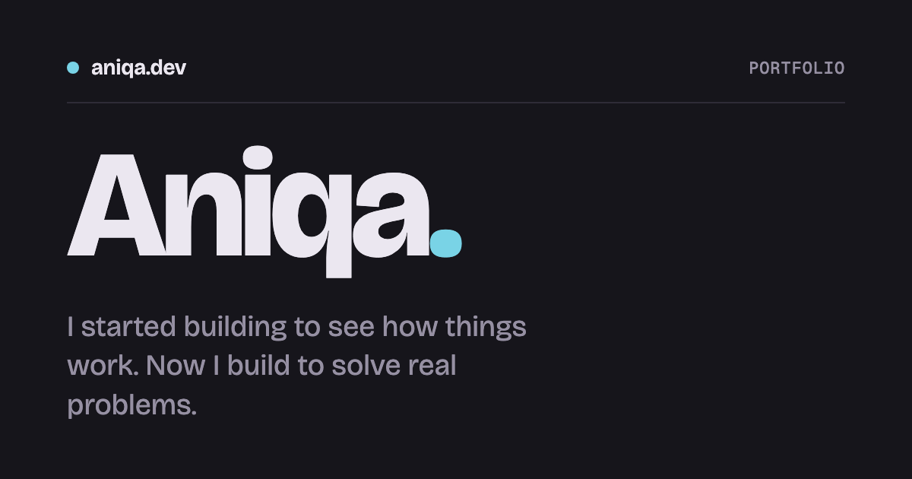
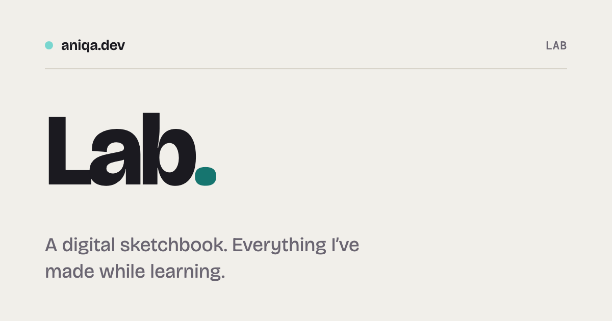

# aniqa.dev

My portfolio at aniqa.dev, with a lab of smaller experiments at aniqa.dev/lab. Built with Astro, hosted on Vercel. _Built with agent assistance from Claude._

**[Live site](https://aniqa.dev)** · **[Lab](https://aniqa.dev/lab)**

| Portfolio (dark)                                                                                      | Lab (light)                                                                              |
| ----------------------------------------------------------------------------------------------------- | ---------------------------------------------------------------------------------------- |
|  |  |

## Tech

- **Astro 7** and **TypeScript** (strict), with plain CSS and theme tokens
- **Upstash Redis** for likes, on **Vercel**
- **Fontsource** for self-hosted Bricolage Grotesque and Geist
- **p5.js** and **Three.js** for experiments that need them
- **Playwright** for smoke tests

## Features

- **Portfolio** (dark): selected projects with case studies and GitHub star counts, and an intro with what I'm building now.
- **Lab** (light): an archive of experiments with hover previews, a random-entry button, and likes (five per visitor).
- **Everywhere**: a share card for each entry, a pet that follows you between pages (a ghost, a bee, a snowball… one of ten, set by hand or by season), and a 404 with a sleeping dot.

## Design

Dark for the portfolio, light for the lab, with a cross-fade between them. One accent: mint on dark, a deeper teal on light. Every preview is a small HTML and CSS drawing rather than a screenshot, so it stays sharp at any size.

## Accessibility

- Every link and button is reachable by keyboard and shows a focus ring (tested).
- Reduced motion stops the drawings and the pet (tested).
- The current page is marked with `aria-current`, and icon-only controls have labels.

## Project structure

```text
src/
  content/      projects/ and experiments/, one folder per entry
  components/   previews, lab rows, cards, the like button, the pet
  pages/        home, case studies, lab, 404, and api/likes.ts
  scripts/      likes, hover preview, scroll counter, pet, sketch runner
  lib/          content helpers, Redis client, GitHub stars, "now" lists
  styles/       theme tokens, drawings, portfolio and lab styles
templates/      starters for npm run new
tests/          Playwright smoke tests
```

## Key concepts

- **One folder per entry.** The folder puts it in the portfolio or the lab, and its frontmatter is checked at build time.
- **Static, plus one function.** Only `/api/likes` runs on the server; every page is built ahead of time.
- **Star counts at build time.** A daily rebuild keeps them current, so visitors never call GitHub.
- **Likes in Redis.** A total per entry and a count per visitor; the sixth like is refused. Visitors are anonymous browser IDs.
- **Drawings** are HTML and CSS on a 200 × 140 board, coloured with the theme tokens `--pf`, `--pm`, `--pl` and `--hi`.
- **Page scripts** set up in `onPage()` and clean up before the next page loads, since pages swap in place.
- **The pet** is one behaviour (`src/scripts/pet.ts`) with swappable drawings in `src/lib/pets.ts`. Set `PET` there to choose one, or to `'auto'` to follow the `SEASONS` calendar (heart for Valentine's, chick in spring, bee in summer, ghost in October, acorn in November, snowball in December, the plain dot otherwise).

## Setup

Requires Node 22.22+. For the tests, also run `npx playwright install chromium`.

```bash
git clone https://github.com/aniqatc/directory
cd directory
npm install
npm run dev    # http://localhost:4321
```

The site builds without any keys; likes and faster star counts need these:

| Variable                                             | For                                           | Where to get it                                                                                      |
| ---------------------------------------------------- | --------------------------------------------- | ---------------------------------------------------------------------------------------------------- |
| `UPSTASH_REDIS_REST_URL`, `UPSTASH_REDIS_REST_TOKEN` | Likes                                         | Vercel → Storage → Upstash Redis, then `vercel env pull .env.local` (`KV_REST_API_*` names work too) |
| `GITHUB_TOKEN`                                       | Star counts (optional, avoids the rate limit) | A read-only GitHub token                                                                             |
| `VERCEL_DEPLOY_HOOK`                                 | Daily star refresh (Actions secret)           | Vercel → Settings → Git → Deploy Hooks                                                               |

### Add an entry

Run `npm run new` and answer the prompts. It creates a folder from [`templates/`](templates) with the frontmatter filled in.

- **Project (portfolio):** choose **project**, then write the blurb, summary and notes in `index.md`. It gets a case study at `/work/<slug>`; `order` sets its place in Selected work.
- **Lab entry that links out:** choose **experiment** → **none**, then write `index.md`.
- **Experiment that runs on the site:** choose **experiment**, then **canvas**, **p5**, **three** or **css**. Each starter already works; replace it with your own. For p5 or Three.js, install the library when asked and restart `npm run dev`.
- **Study (one idea with controls):** choose **experiment** → **study**. Its stage grows to fit it, and `src/styles/demo.css` has the buttons, sliders and lines that make it match the lab. `example-study` shows one.

Optional fields for experiments: `themes: true` adds a Day / Night switch under the stage, and `headsUp: "…"` adds a "Before you start" box (for any lab entry; use it rarely).

Then, for any entry: replace the placeholder drawing in `preview.astro`, run `npm run og` for its share card, and check the page. Set `draft: true` to hide it until it's ready.

With Claude Code, `/new-project`, `/new-experiment` and `/new-drawing` do the writing and drawing for you.

## Scripts

| Command                             | What it does                     |
| ----------------------------------- | -------------------------------- |
| `npm run dev`                       | Local site at `localhost:4321`   |
| `npm run build`                     | Type-check, then build           |
| `npm test`                          | Playwright smoke tests           |
| `npm run new`                       | Add a project or experiment      |
| `npm run og`                        | Make share cards for every entry |
| `npm run check` / `lint` / `format` | Type-check, lint, format         |

## Changelog

### October 2026

- Rebuilt in Astro, replacing the React version (kept at the `react-v1` tag).
- Added the lab, likes in Upstash, and build-time star counts.
- Added the 404 page, the pet, page transitions and share cards.
- Gave the pet ten looks, including seasonal ones; the ghost is out for October.

### 2025

- Updated the React portfolio.

## License

Code is [MIT](LICENSE): reuse it freely, keeping the copyright notice. The writing, experiments and images are © Aniqa, all rights reserved.
