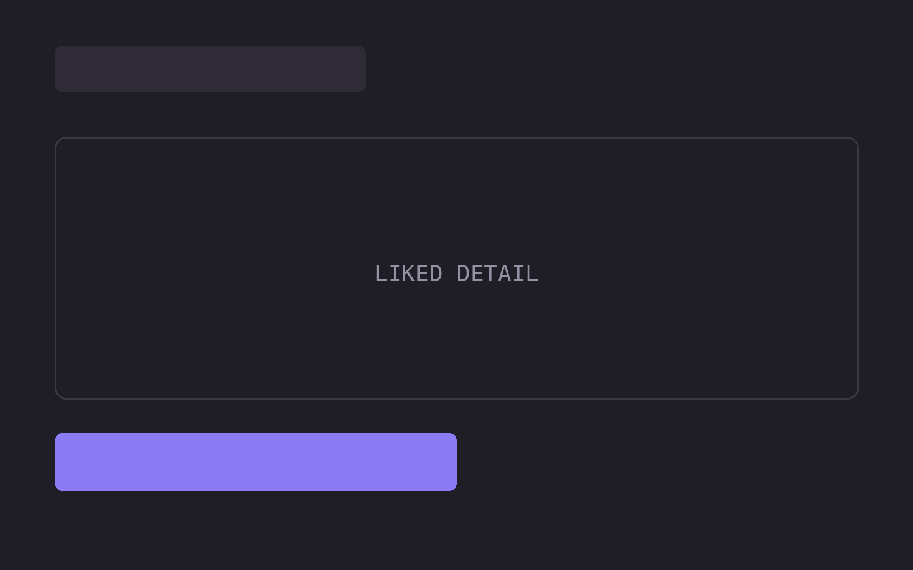
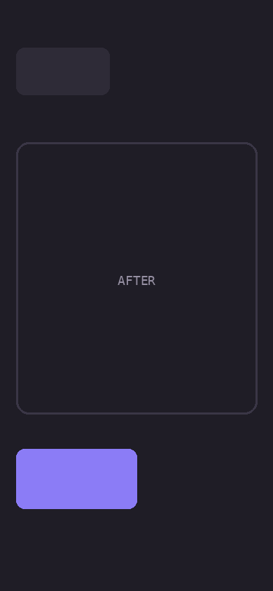

---
# A draft that shows every part of a review. Drafts only appear on the dev server (npm run dev).
# Copy this folder for a new review: rename it to the app's slug, swap the images, set draft: false.
app: Example App
maker: example
date: 2026-10-30
type: Web app
triedOn: MacBook, Chrome
live: example.com
summary: One line on what the app does and who it's for.
verdict: Promising
brand: '#8b7cf6'
scores:
  firstImpression: 4
  onboarding: 3
  bestFeature: 5
  easeOfUse: 4
  value: 2
screenshotAlt: The app's home screen.
draft: true
---

## First look

Two or three sentences on the first five minutes: signing up, the empty state, and the moment it clicked.

## What I liked

1. A specific detail that worked well, with a screenshot of it.

   
   _What the screenshot shows_

2. A mobile detail, shown as two phone screens side by side.

    
   _What changes between the two_

3. A small touch that doesn't need a picture.

## Small ideas

1. A gentle suggestion, phrased as something to try.
2. Another idea, ideally small enough to ship this week.

## Who it's for

One sentence on who would love this app.
