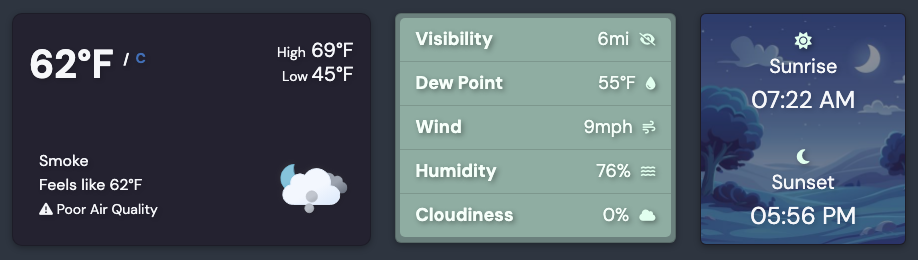
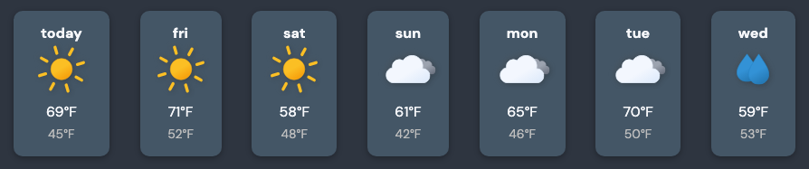
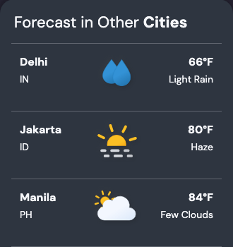

---
# A sample review of my own Weather dashboard, to see the layout with real pictures. It's a draft, so it only
# shows on npm run dev. logo.png is a stand-in; the other pictures are crops of the Weather screenshot.
app: Weather
maker: aniqatc
date: 2026-10-30
type: Dashboard
triedOn: MacBook, Chrome
live: weather.aniqa.dev
summary: A light and dark weather dashboard with live conditions and a 7-day forecast for any city.
verdict: Solid
brand: '#1e7fd0'
stillUsing: true
scores:
  firstImpression: 4
  onboarding: 4
  bestFeature: 5
  easeOfUse: 4
  value: 3
screenshotAlt: "Weather Dashboard in dark mode: today's forecast for New York with temperature, visibility, wind and humidity, sunrise and sunset times, the week ahead, and the weather in five other cities."
draft: true
---

## First look

[Two or three sentences on the first five minutes with the dashboard.]

## What I liked

1. Everything about today is on one row: the temperature, the details, and sunrise and sunset in the city's own time zone.

   
   _Today in New York, with sunrise and sunset in local time_

2. The week ahead reads at a glance, with highs and lows for each day.

   
   _The 7-day forecast_

3. Five random cities sit beside your own, and clicking one loads it.

   
   _Forecast in other cities_

4. It remembers your city and theme, and works offline after the first visit.

## Small ideas

1. [A gentle suggestion, phrased as something to try.]
2. [Another idea, ideally small enough to ship this week.]

## Who it's for

[One sentence on who would love this app.]
